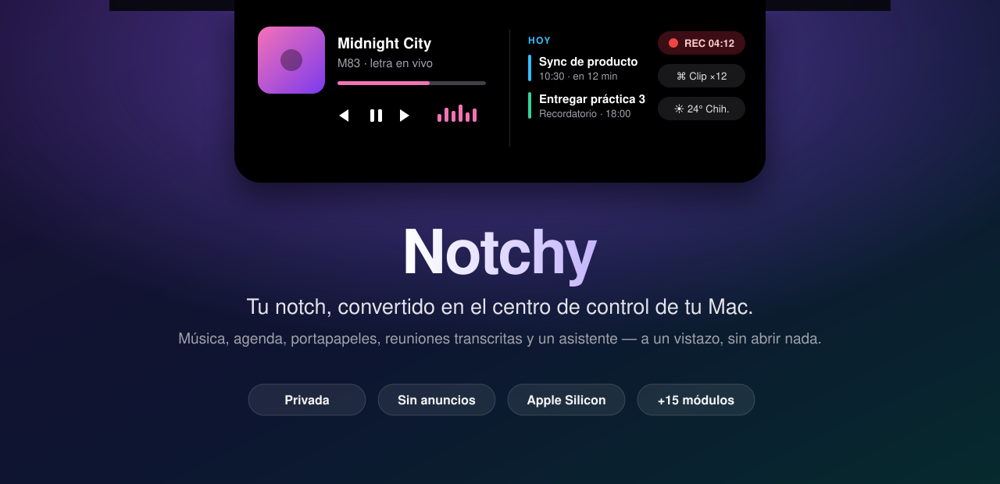
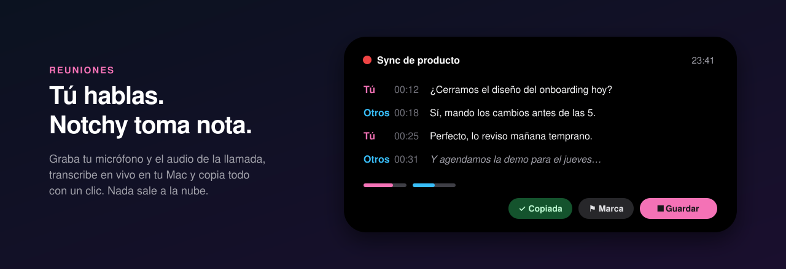

<p align="center">
  
</p>

<p align="center">
  <b>Ese hueco negro arriba de tu pantalla por fin sirve para algo.</b><br>
  Pasa el cursor por el notch y tu Mac te muestra justo lo que necesitas, en el momento en que lo necesitas.
</p>

<p align="center">
  
  
  
  
</p>

---

## Todo a un vistazo, sin abrir nada

Notchy vive en el notch de tu MacBook. No ocupa espacio en el Dock ni llena la pantalla de ventanas: se abre al acercar el cursor y se esconde cuando terminas.

<table>
  <tr>
    <td width="33%" valign="top">
      <h3>🎵 Ahora suena</h3>
      Carátula, controles y <b>letra sincronizada estilo karaoke</b>. Toca cualquier verso para saltar a esa parte.
    </td>
    <td width="33%" valign="top">
      <h3>📅 Agenda</h3>
      Tus eventos y pendientes del día, con un aviso elegante justo antes de cada llamada.
    </td>
    <td width="33%" valign="top">
      <h3>🎙️ Reuniones</h3>
      Graba y <b>transcribe en vivo</b> lo que dices tú y lo que dicen los demás. Cópialo todo con un clic.
    </td>
  </tr>
  <tr>
    <td valign="top">
      <h3>📋 Portapapeles</h3>
      Todo lo que copiaste, en tarjetas visuales. Busca, recupera y vuelve a pegar en segundos.
    </td>
    <td valign="top">
      <h3>📂 Bandeja de archivos</h3>
      Arrastra archivos al notch, déjalos ahí y llévatelos a donde quieras después.
    </td>
    <td valign="top">
      <h3>📡 AirDrop</h3>
      Envía y recibe con vista previa, directo desde el notch.
    </td>
  </tr>
  <tr>
    <td valign="top">
      <h3>🌐 Traductor</h3>
      Traduce al instante, en tu propia Mac, sin copiar y pegar en otra página.
    </td>
    <td valign="top">
      <h3>✨ Asistente</h3>
      Un mini chat que te ayuda a resolver cosas sin salir de lo que estás haciendo.
    </td>
    <td valign="top">
      <h3>🪟 Window Snap</h3>
      Acomoda la ventana activa en mitades, tercios, cuartos o a pantalla completa con un toque.
    </td>
  </tr>
  <tr>
    <td valign="top">
      <h3>🔔 Notificaciones</h3>
      Las últimas notificaciones de tu Mac juntas, para que no se te pase nada.
    </td>
    <td valign="top">
      <h3>⏱️ Tiempo en pantalla</h3>
      Descubre en qué se te va el día, con gráficas por categoría y ranking de apps.
    </td>
    <td valign="top">
      <h3>📈 Monitor del sistema</h3>
      CPU, memoria y almacenamiento en anillos que se leen de un vistazo.
    </td>
  </tr>
  <tr>
    <td valign="top">
      <h3>🎨 Selector de color</h3>
      Toma cualquier color de la pantalla y cópialo en HEX, RGB o HSL. Incluye revisión de contraste.
    </td>
    <td valign="top">
      <h3>🪞 Espejo</h3>
      Revisa cómo te ves antes de entrar a una videollamada, y toma una foto si quieres.
    </td>
    <td valign="top">
      <h3>☀️ Clima</h3>
      El pronóstico de tu ciudad, siempre a la mano.
    </td>
  </tr>
</table>

---

<p align="center">
  
</p>

### Nunca vuelvas a tomar notas en una llamada

- **Tú y los demás, separados.** Notchy distingue lo que dices tú de lo que se oye en la llamada.
- **Transcripción en vivo**, en español o en inglés, mientras hablas.
- **Marcas de tiempo** para señalar los momentos importantes con un clic.
- **Historial con buscador**: encuentra lo que se dijo hace semanas, aunque escribas sin acentos.
- **Copiar transcripción** al portapapeles para pegarla en tus notas, en un correo o en tu chat.

---

## Pensada para sentirse de Apple

| | |
|---|---|
| 🌙 **Discreta** | Se esconde sola. Solo aparece cuando la buscas. |
| ⚡ **Rápida** | Hecha en Swift nativo para Apple Silicon. Sin Electron y sin pantallas de carga. |
| 🔒 **Privada** | La transcripción de reuniones y la traducción ocurren en tu Mac. Tus datos se quedan contigo. |
| 🎛️ **Tuya** | Activa solo los módulos que usas y ordénalos a tu gusto. |
| 🔊 **Detalles finos** | Indicadores de volumen y brillo rediseñados, animaciones suaves y modo oscuro de verdad. |

---

## Empieza en un minuto

1. Abre **Notchy**.
2. Acerca el cursor al notch.
3. Listo. Notchy te pide cada permiso (micrófono, calendario, accesibilidad) solo cuando usas el módulo que lo necesita, nunca antes.

> **Requisitos:** MacBook con notch y chip Apple Silicon, con macOS 27 o posterior.

---

## Preguntas frecuentes

<details>
<summary><b>¿Necesito internet?</b></summary>

La mayoría de los módulos funcionan sin conexión. El clima y el asistente sí necesitan internet.
</details>

<details>
<summary><b>¿Mis reuniones se suben a algún servidor?</b></summary>

No. El audio y la transcripción se guardan y procesan en tu Mac.
</details>

<details>
<summary><b>¿Funciona en Macs sin notch?</b></summary>

Está diseñada para el notch. En pantallas sin notch, la isla aparece en el borde superior al centro.
</details>

---

<details>
<summary><b>Para desarrolladores</b></summary>

### Requisitos

- Xcode 27.2 (Swift 6.4) con un certificado Apple Development del equipo `3GB89AS998`.
- OpenCode en la versión de `Resources/opencode/VERSION` (para el asistente).

### Comandos

| Comando | Qué hace |
|---|---|
| `scripts/check` | Formato, regla de capas, plist, secretos, paquete en modo estricto con pruebas, app y firma. Tiene que pasar antes de unir a `main`. |
| `scripts/run` | Compila, firma, instala en `/Applications/Notchy.app` y la abre. |
| `scripts/verificar-firma` | Muestra identidad, equipo y entitlements de la app compilada. |

Los registros largos quedan en `build/logs`. Para trabajar solo en el paquete: `swift test --package-path Packages/NotchyKit`.

### Estructura

```
App/                 arranque, Info.plist, entitlements y assets
Config/              ajustes de compilación (.xcconfig)
Packages/NotchyKit/  todas las capas y sus pruebas
Resources/           OpenCode y MediaRemote
scripts/             check, run, verificar-firma
docs/                arquitectura e imágenes del README
```

Las capas y sus reglas están en `docs/arquitectura.md` y `AGENTS.md`. El identificador `dev.darian.notchy` y el equipo de firma viven en `Config/Base.xcconfig`; cambiarlos reinicia todos los permisos del sistema.
</details>

<p align="center"><sub>Hecha con cariño en Chihuahua, México, por <a href="https://github.com/darian1204">Darian Maynez</a>.</sub></p>
