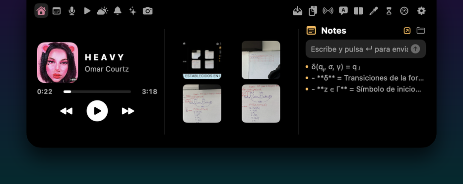
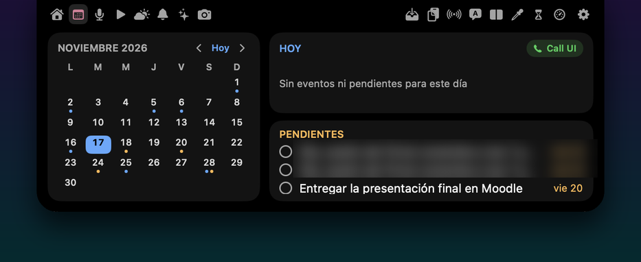
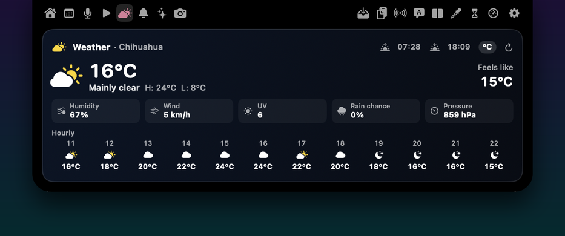
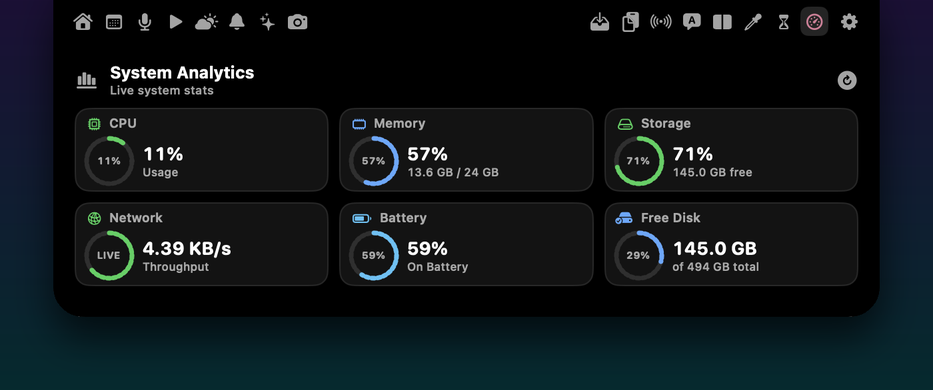
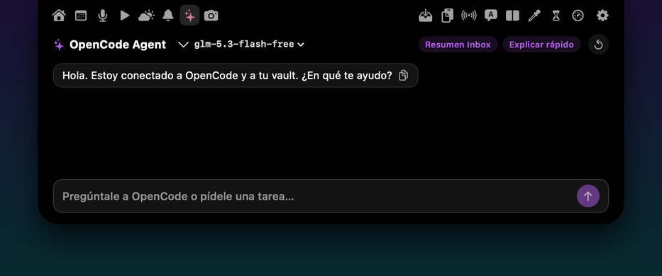

<h1 align="center">Notchy</h1>

<p align="center">
  <b>Ese hueco negro arriba de tu pantalla por fin sirve para algo.</b><br>
  Pasa el cursor por el notch y tu Mac te muestra justo lo que necesitas, en el momento en que lo necesitas.
</p>

<p align="center">
  
  
  
  
  
</p>

<p align="center">
  
</p>

<p align="center"><sub>Capturas reales de Notchy en una MacBook Air M4.</sub></p>

---

## Todo a un vistazo, sin abrir nada

Notchy vive en el notch de tu MacBook. No ocupa espacio en el Dock ni llena la pantalla de ventanas: se abre al acercar el cursor y se esconde cuando terminas. Arriba tienes una fila de íconos; cada uno abre un módulo.

### 🏠 Inicio
Lo que está sonando, tus archivos recientes y una nota rápida que va directo a tu Obsidian. Todo en una sola vista.

### 🎙️ Reuniones y clases que se resumen solas
Graba tu micrófono y el audio de la llamada, **transcribe en vivo** y, al terminar, **Apple Intelligence escribe el resumen** y lo deja en tu inbox de Obsidian. Copia la transcripción completa con un clic. Todo pasa en tu Mac.

<p align="center"></p>

### 📅 Agenda
Calendario del mes, eventos del día y pendientes de Recordatorios, con un aviso estilo llamada antes de cada reunión.

<p align="center"></p>

### ☀️ Clima
Temperatura, sensación térmica, viento, UV y pronóstico por hora de tu ciudad.

<p align="center"></p>

### 🪟 Window Snap
Acomoda la ventana activa en mitades, tercios, cuartos o a pantalla completa con un toque.

<p align="center"></p>

### 🌐 Traductor
Traduce al instante entre idiomas con el traductor de Apple, sin internet y sin abrir otra página.

<p align="center"></p>

### 📈 Monitor del sistema
CPU, memoria, almacenamiento, red y batería en anillos que se leen de un vistazo.

<p align="center"></p>

### ⏱️ Tiempo en pantalla
Descubre en qué se te va el día: categorías, sesiones y ranking de apps.

<p align="center"></p>

### 🎨 Selector de color
Toma cualquier color de la pantalla y cópialo en HEX, RGB, HSL o Swift. Incluye revisión de contraste.

<p align="center"></p>

### 📂 Bandeja de archivos
Arrastra archivos al notch para guardarlos, convertirlos, mandarlos por AirDrop o subirlos a iCloud.

<p align="center"></p>

### ✨ Asistente
Un mini chat para resolver cosas rápidas sin salir de lo que estás haciendo.

<p align="center"></p>

### Y además
🎵 **Ahora suena** con letra sincronizada estilo karaoke · 📋 **Portapapeles** con historial visual · 📡 **AirDrop** con vista previa · 🔔 **Notificaciones** recientes de tu Mac · 🪞 **Espejo** para revisarte antes de una videollamada

---

## Pensada para sentirse de Apple

| | |
|---|---|
| 🌙 **Discreta** | Se esconde sola. Solo aparece cuando la buscas. |
| ⚡ **Rápida** | Hecha en Swift nativo para Apple Silicon. Sin Electron y sin pantallas de carga. |
| 🔒 **Privada** | Las transcripciones, los resúmenes y la traducción se hacen en tu Mac. Tus datos se quedan contigo. |
| 🎛️ **Tuya** | Activa solo los módulos que usas y ordénalos a tu gusto. |
| 🔊 **Detalles finos** | Indicadores de volumen y brillo rediseñados, animaciones suaves y temas para la isla. |

---

## Empieza en un minuto

1. Abre **Notchy**.
2. Acerca el cursor al notch (o usa <kbd>⌃</kbd> <kbd>⌥</kbd> <kbd>Espacio</kbd>).
3. Listo. Notchy te pide cada permiso (micrófono, calendario, accesibilidad) solo cuando usas el módulo que lo necesita, nunca antes.

> **Requisitos:** MacBook con notch y chip Apple Silicon, con macOS 27 o posterior. Para los resúmenes de reuniones, Apple Intelligence activado.

---

## Preguntas frecuentes

<details>
<summary><b>¿Cuánto cuesta?</b></summary>

Nada. Notchy es un proyecto personal que comparto con amigos. No tiene anuncios ni suscripciones.
</details>

<details>
<summary><b>¿Necesito internet?</b></summary>

La mayoría de los módulos funcionan sin conexión. El clima y el asistente sí necesitan internet.
</details>

<details>
<summary><b>¿Mis reuniones se suben a algún servidor?</b></summary>

No. El audio, la transcripción y el resumen se guardan y procesan en tu Mac.
</details>

<details>
<summary><b>¿Puedo apagar el resumen automático?</b></summary>

Sí: Ajustes → Reuniones → "Resumir cada reunión en el inbox de Obsidian".
</details>

<details>
<summary><b>¿Funciona en Macs sin notch?</b></summary>

Está diseñada para el notch. En pantallas sin notch, la isla aparece en el borde superior al centro.
</details>

---

<details>
<summary><b>Para desarrolladores</b></summary>

### Requisitos

- Xcode 27.2 (Swift 6.4) con un certificado Apple Development del equipo `3GB89AS998`.
- OpenCode en la versión de `Resources/opencode/VERSION` (para el asistente).

### Comandos

| Comando | Qué hace |
|---|---|
| `scripts/check` | Formato, regla de capas, plist, secretos, paquete en modo estricto con pruebas, app y firma. Tiene que pasar antes de unir a `main`. |
| `scripts/run` | Compila, firma, instala en `/Applications/Notchy.app` y la abre. |
| `scripts/verificar-firma` | Muestra identidad, equipo y entitlements de la app compilada. |

Los registros largos quedan en `build/logs`. Para trabajar solo en el paquete: `swift test --package-path Packages/NotchyKit`.

### Estructura

```
App/                 arranque, Info.plist, entitlements y assets
Config/              ajustes de compilación (.xcconfig)
Packages/NotchyKit/  todas las capas y sus pruebas
Resources/           OpenCode y MediaRemote
scripts/             check, run, verificar-firma
docs/                arquitectura e imágenes del README
```

Las capas y sus reglas están en `docs/arquitectura.md` y `AGENTS.md`. El identificador `dev.darian.notchy` y el equipo de firma viven en `Config/Base.xcconfig`; cambiarlos reinicia todos los permisos del sistema.
</details>

<p align="center"><sub>Código abierto bajo licencia <a href="LICENSE">MIT</a>. Hecha con cariño en Chihuahua, México, por <a href="https://github.com/darian1204">Darian Maynez</a>.</sub></p>
