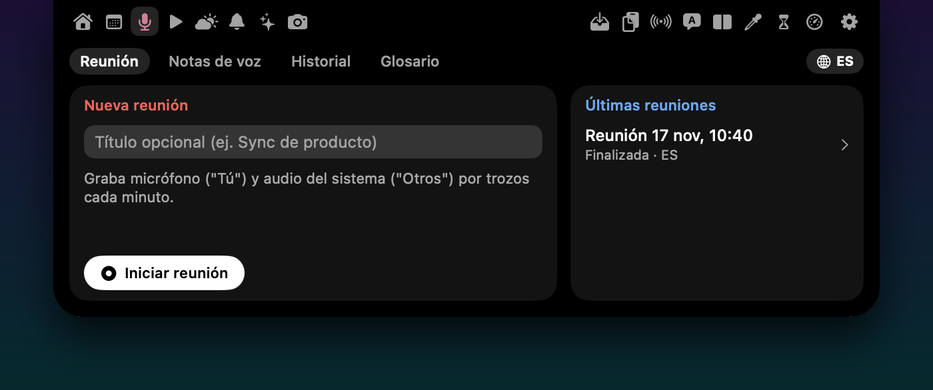
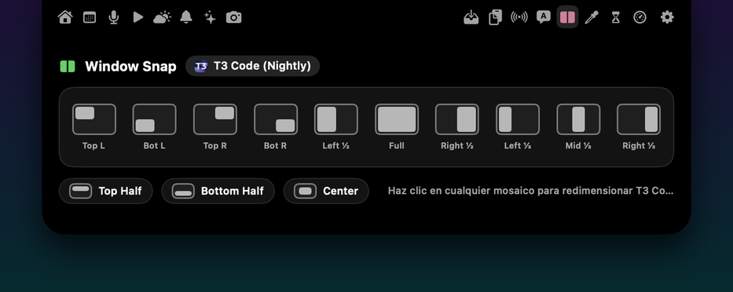
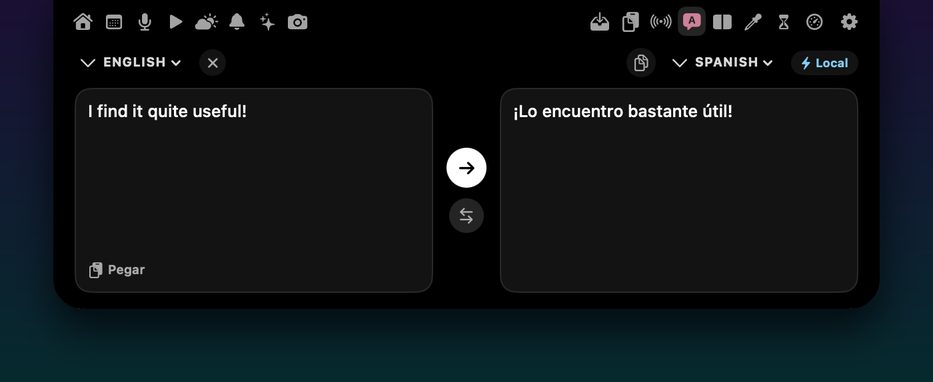
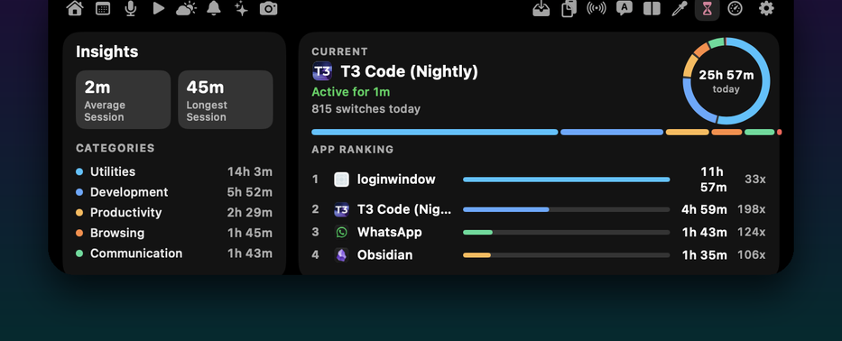
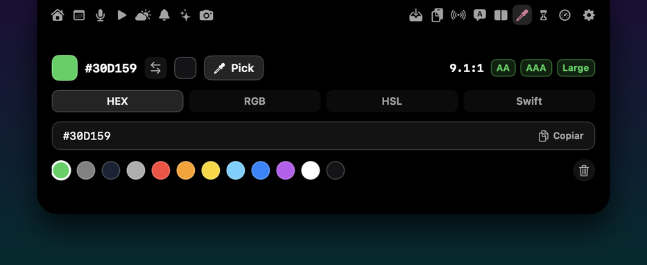
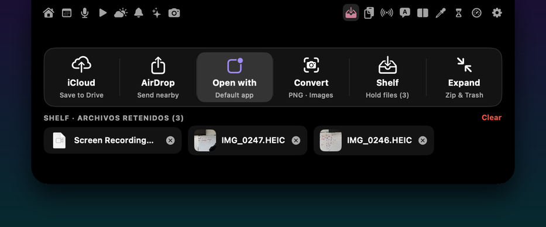
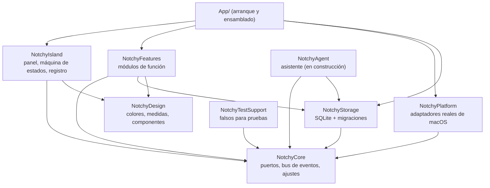

<h1 align="center">Notchy</h1>

<p align="center">
  <b>Ese hueco negro arriba de tu pantalla por fin sirve para algo.</b><br>
  Una isla nativa en el notch de tu MacBook: reuniones que se resumen solas, agenda, portapapeles, archivos y más, a un cursor de distancia.
</p>

<p align="center">
  
  
  
  
  
  
</p>

<p align="center">
  
</p>

<p align="center"><sub>Capturas reales de Notchy en una MacBook Air M4.</sub></p>

---

## 🧭 Qué es

Notchy es una app de barra de menús (sin ícono en el Dock) que dibuja un panel sobre el notch. Acercas el cursor y se abre; sacas el cursor y se esconde. Cada función es un **módulo** que se registra en la isla.

- 🎙️ Graba micrófono y audio del sistema, transcribe en vivo y resume con Apple Intelligence.
- 📅 Agenda con Calendario y Recordatorios, y aviso antes de cada reunión.
- 📋 Portapapeles con historial, bandeja de archivos y AirDrop.
- 🪟 Window Snap, monitor del sistema, tiempo en pantalla y selector de color.
- 🔒 Nativa y local: sin Electron, y el audio y las transcripciones no salen de tu Mac.

---

## ✨ Qué incluye

Notchy vive en el notch de tu MacBook. No ocupa espacio en el Dock ni llena la pantalla de ventanas: se abre al acercar el cursor y se esconde cuando terminas. Arriba tienes una fila de íconos; cada uno abre un módulo.

### 🏠 Inicio
Lo que está sonando, tus archivos recientes y una nota rápida que va directo a tu Obsidian. Todo en una sola vista.

### 🎙️ Reuniones y clases que se resumen solas
Graba tu micrófono y el audio de la llamada, **transcribe en vivo** y, al terminar, **Apple Intelligence escribe el resumen** y lo deja en tu inbox de Obsidian. Copia la transcripción completa con un clic. Todo pasa en tu Mac.

<p align="center"></p>

### 📅 Agenda
Calendario del mes, eventos del día y pendientes de Recordatorios, con un aviso estilo llamada antes de cada reunión.

<p align="center"></p>

### ☀️ Clima
Temperatura, sensación térmica, viento, UV y pronóstico por hora de tu ciudad.

<p align="center"></p>

### 🪟 Window Snap
Acomoda la ventana activa en mitades, tercios, cuartos o a pantalla completa con un toque.

<p align="center"></p>

### 🌐 Traductor
Traduce al instante entre idiomas con el traductor de Apple, sin internet y sin abrir otra página.

<p align="center"></p>

### 📈 Monitor del sistema
CPU, memoria, almacenamiento, red y batería en anillos que se leen de un vistazo.

<p align="center"></p>

### ⏱️ Tiempo en pantalla
Descubre en qué se te va el día: categorías, sesiones y ranking de apps.

<p align="center"></p>

### 🎨 Selector de color
Toma cualquier color de la pantalla y cópialo en HEX, RGB, HSL o Swift. Incluye revisión de contraste.

<p align="center"></p>

### 📂 Bandeja de archivos
Arrastra archivos al notch para tenerlos a la mano, convertir imágenes, comprimirlos o subirlos a iCloud. El Shelf se vacía solo a los 10 minutos, así nunca se llena.

<p align="center"></p>

### ✨ Asistente
Un mini chat para resolver cosas rápidas sin salir de lo que estás haciendo.

<p align="center"></p>

### Y además
🎵 **Ahora suena** con letra sincronizada estilo karaoke · 📋 **Portapapeles** con historial visual que se borra solo después de una hora · 📡 **AirDrop** con vista previa · 🔔 **Notificaciones** recientes de tu Mac · 🪞 **Espejo** para revisarte antes de una videollamada

---

## Pensada para sentirse de Apple

| | |
|---|---|
| 🌙 **Discreta** | Se esconde sola. Solo aparece cuando la buscas. |
| ⚡ **Rápida** | Hecha en Swift nativo para Apple Silicon. Sin Electron y sin pantallas de carga. |
| 🔒 **Privada** | Las transcripciones, los resúmenes y la traducción se hacen en tu Mac. Tus datos se quedan contigo. |
| 🎛️ **Tuya** | Activa solo los módulos que usas y ordénalos a tu gusto. |
| 🔊 **Detalles finos** | Indicadores de volumen y brillo rediseñados, animaciones suaves y temas para la isla. |

---

## Empieza en un minuto

1. Abre **Notchy**.
2. Acerca el cursor al notch (o usa <kbd>⌃</kbd> <kbd>⌥</kbd> <kbd>Espacio</kbd>).
3. Listo. Notchy te pide cada permiso (micrófono, calendario, accesibilidad) solo cuando usas el módulo que lo necesita, nunca antes.

> **Requisitos:** MacBook con notch y chip Apple Silicon, con macOS 27 o posterior. Para los resúmenes de reuniones, Apple Intelligence activado.

---

## Preguntas frecuentes

<details>
<summary><b>¿Cuánto cuesta?</b></summary>

Nada. Notchy es un proyecto personal que comparto con amigos. No tiene anuncios ni suscripciones.
</details>

<details>
<summary><b>¿Necesito internet?</b></summary>

La mayoría de los módulos funcionan sin conexión. El clima y el asistente sí necesitan internet. La separación de voces en reuniones usa internet solo la primera vez para descargar a tu Mac los modelos locales de CoreML (FluidAudio).
</details>

<details>
<summary><b>¿Mis reuniones se suben a algún servidor?</b></summary>

No. El audio, la transcripción, la separación de voces (diarización local con FluidAudio/CoreML) y el resumen se guardan y procesan en tu Mac; la única conexión de red de la grabadora es la descarga única de los modelos de diarización la primera vez que se usa.
</details>

<details>
<summary><b>¿Puedo apagar el resumen automático?</b></summary>

Sí: Ajustes → Reuniones → "Resumir cada reunión en el inbox de Obsidian".
</details>

<details>
<summary><b>¿Funciona en Macs sin notch?</b></summary>

Está diseñada para el notch. En pantallas sin notch, la isla aparece en el borde superior al centro.
</details>

---

## 🏗️ Arquitectura

Notchy es un paquete de Swift (`NotchyKit`) dividido en capas con dependencias en una sola dirección, más una app delgada que las ensambla. Los módulos nunca tocan el sistema: piden lo que necesitan por **puertos** (protocolos) definidos en `NotchyCore`, y `NotchyPlatform` trae los adaptadores reales. Por eso cada módulo se prueba con falsos.



| Capa | Rol | Depende de |
|---|---|---|
| `NotchyCore` | Puertos, contrato `ModuloDeIsla`, bus de eventos, ajustes, permisos, errores y logs | nada |
| `NotchyDesign` | Paleta, medidas, forma de la isla y componentes de SwiftUI | nada |
| `NotchyStorage` | SQLite con GRDB, migraciones que solo avanzan y repositorios | Core |
| `NotchyPlatform` | Adaptadores reales: audio, transcripción, EventKit, cámara, portapapeles, AirDrop, atajos globales, OpenCode | Core |
| `NotchyIsland` | Ventana del panel, geometría, máquina de estados y registro de módulos | Core, Design |
| `NotchyFeatures` | Un módulo por función (agenda, grabadora, bandeja, clima, etc.) | Core, Storage, Design |
| `NotchyAgent` | Capa reservada para el asistente (supervisor de OpenCode y servidor MCP) | Core, Storage |
| `NotchyTestSupport` | Falsos y datos de prueba | Core |

La regla de capas no es solo una convención: `Package.swift` la declara y `scripts/check` la verifica contra los `import` de cada archivo.

### Piezas clave

- **`ModuloDeIsla`**: contrato que cumple cada módulo (identidad, tamaño, vista expandida, vistas compactas opcionales, aviso temporal, `arrancar()` y `detener()`).
- **`MaquinaDeIsla`**: reglas puras de la isla. Recibe entradas y devuelve el estado nuevo (`reposo`, `compacto`, `aviso`, `expandido`) y los temporizadores a programar. No usa ventanas ni relojes, así que se prueba completa.
- **`BusDeEventos`**: los módulos se comunican con eventos tipados, sin conocerse entre sí.
- **`Ensamblado`**: único lugar que crea adaptadores reales y los inyecta en los módulos.

### Flujo principal

1. El cursor llega al notch y `NotchyIsland` pasa la máquina de `reposo` a `expandido`.
2. El registro activa el módulo de Inicio; el resto se abre desde la fila de íconos.
3. El módulo llama a un puerto de `NotchyCore` (por ejemplo, el calendario o el portapapeles).
4. `NotchyPlatform` resuelve la llamada con la API de macOS y pide el permiso solo en ese momento.
5. Lo que debe persistir (portapapeles, bandeja, reuniones) pasa por un repositorio de `NotchyStorage`.
6. Si algo requiere atención, el módulo emite un evento y la isla muestra un aviso o un estado compacto.

---

## 🛠️ Para desarrolladores

### Stack y requisitos

| Área | Tecnología |
|---|---|
| Lenguaje | Swift 6 (modo estricto en `scripts/check`) |
| UI | SwiftUI + AppKit para el panel |
| Persistencia | SQLite con [GRDB.swift](https://github.com/groue/GRDB.swift) 7 |
| Agente | [MCP Swift SDK](https://github.com/modelcontextprotocol/swift-sdk) y OpenCode (versión fijada en `Resources/opencode/VERSION`) |
| Sistema | EventKit, Speech, FoundationModels (Apple Intelligence), AVFoundation, Carbon (atajos globales) |
| Música | [mediaremote-adapter](Resources/mediaremote-adapter/LICENSE) (BSD-3) |
| Herramientas | Xcode 27.2 (Swift 6.4) y un certificado Apple Development propio |

### Compilar y correr

```bash
swift test --package-path Packages/NotchyKit   # pruebas del paquete
scripts/check                                  # verificación completa
scripts/run                                    # compila, firma, instala y abre la app
```

| Script | Qué hace |
|---|---|
| `scripts/check` | Formato, regla de capas, plist, secretos, paquete estricto con pruebas, app y firma. Debe pasar antes de unir a `main`. |
| `scripts/run` | Compila, firma, instala en `/Applications/Notchy.app` y la abre. |
| `scripts/verificar-firma` | Muestra identidad, equipo y entitlements de la app compilada. |

El identificador de la app y el equipo de firma viven en `Config/Base.xcconfig`; si compilas con tu propio certificado, cámbialos ahí. Cambiarlos reinicia los permisos del sistema. Los registros largos quedan en `build/logs`.

### Estructura

```
App/                 arranque, ensamblado, Info.plist, entitlements y assets
Config/              ajustes de compilación (.xcconfig)
Packages/NotchyKit/  capas del paquete y sus pruebas
Resources/           plantilla de OpenCode y MediaRemote
scripts/             check, run, verificar-firma
docs/                arquitectura e imágenes del README
```

Más detalle en `docs/arquitectura.md` y `AGENTS.md`.

---

## 🗺️ Estado y roadmap

Proyecto personal en desarrollo activo; los 15 módulos de arriba ya funcionan en `main`.

- [x] Isla base, grabadora con resumen, portapapeles, bandeja, agenda, extras y pulido de rendimiento.
- [ ] Rediseño de la isla con estilo de tarjetas (en una rama de trabajo).
- [ ] Capa `NotchyAgent` completa (supervisor de OpenCode y servidor MCP).
- [ ] Pruebas manuales largas de la grabadora (60 minutos y medición de energía).

---

<p align="center"><sub>Código abierto bajo licencia <a href="LICENSE">MIT</a>. Hecha con cariño en Chihuahua, México, por <a href="https://github.com/darian1204">Darian Maynez</a>.</sub></p>
